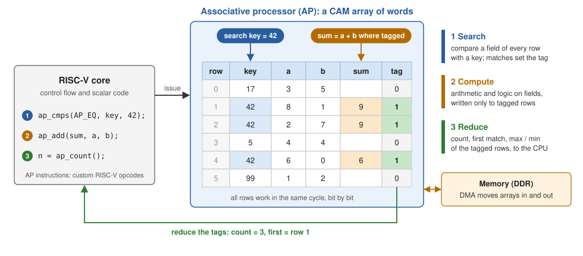

# Associative Processor on FPGA

[](https://github.com/hongzhengTian/Associative-Processor-on-FPGA/actions/workflows/ci.yml)

An associative processor (AP) for FPGAs, attached to a RISC-V core. The AP is
a content-addressable memory (CAM) that computes: it searches all of its words
at once, updates the matching ones, and reduces the result to a single value,
so the time of an operation depends on the width of the data, not on how many
words it touches.



## Associative processing

An associative processor stores data as words in a CAM array and works on all
words in parallel with three kinds of operations:

* **Search.** A key is compared with a field (a bit range) of every word.
  Each word has a **tag** bit, which records whether it matched.
* **Compute.** Writes go only to tagged words. Arithmetic is carried out
  **bit-serially and word-parallel**: one bit position per step, in every
  word at the same time, with a carry kept per word. An operation on L-bit
  fields takes about L steps for any number of words.
* **Reduce.** The tags are turned back into a scalar for the processor:
  how many words matched, the first match, the largest or smallest value.

This design implements that model on an FPGA. The array is held in bit
planes (each plane is one bit position of every word) in distributed RAM,
and each word has a one-bit ALU that performs the compare and write steps of
one bit position in a single clock cycle. A PicoRV32 core runs the program
and issues AP operations as custom RISC-V instructions written in plain C;
a DMA engine moves arrays between memory and the array.

## Highlights

* Parameterized array, up to 65536 words of 2048 bits; any bit range of a word
  is an operand.
* 43 operations: field arithmetic and logic (with a field or a scalar), ten
  compare conditions that set, AND or OR the tags, COUNT, FIRST, MAX/MIN,
  element access, a 32 x 32 transpose buffer and AXI4 DMA.
* C interface `ap.h`; the stock RISC-V GCC builds the programs.
* Verified by random testing against a reference model and by C programs on
  the full system; open-source flow (Verilator, Yosys) in CI.
* Runs on a Zynq-7000 board with the ARM core as host, which also provides a
  CPU baseline for the benchmark.

## Results

AP cycles stay flat as the number of elements grows (simulation, 512 x 64
array as built for the Zynq board, cycles including issuing the instructions
from the RISC-V core):

| Workload | n = 32 | 64 | 128 | 256 | 512 |
|---|---:|---:|---:|---:|---:|
| add, 16-bit | 46 | 46 | 46 | 46 | 46 |
| range query (3 conditions) and count | 88 | 88 | 88 | 88 | 88 |
| arg-max, 20-bit | 44 | 44 | 44 | 45 | 47 |
| 16-bin histogram | 764 | 764 | 764 | 764 | 764 |
| top 8 | 576 | 576 | 576 | 579 | 586 |

The example programs on the 256 x 128 SoC, each against the same work in
plain C on the PicoRV32 (`make test`):

| Example | CPU cycles | AP cycles |
|---|---:|---:|
| vector add, 256 elements | 12,305 | 34 (1,404 including DMA in and out) |
| search key == k and fetch the values | 7,783 | 235 |
| range query on two fields, count | 10,589 | 105 |
| 16-bin histogram of 256 bytes | 14,349 | 754 |
| top 8 of 256 values | 98,957 | 697 |

PicoRV32 is a small multi-cycle core, so these ratios flatter the AP. The board
build compares against the Cortex-A9 of the Zynq instead (see
[docs/zynq.md](docs/zynq.md)).

## Quick start

Requirements: Verilator 5, a RISC-V GCC (`riscv64-unknown-elf-gcc`) and
Python 3; Yosys for synthesis; `gcc-arm-none-eabi` for the host-program check.
On Ubuntu 24.04:

```bash
sudo apt-get install verilator gcc-riscv64-unknown-elf gcc-arm-none-eabi yosys
```

```bash
make test                        # build the software, run all simulations
make -C sim run PROG=search      # run one program on the simulated SoC
make synth                       # Yosys synthesis and resource summary
```

A program:

```c
#include "ap.h"

const ap_field_t key = AP_FIELD(0, 12), value = AP_FIELD(12, 16);

ap_dma_config(table_addr, n);        // one record per word
ap_dma_load(key, 0);
ap_tag_range(0, n);
ap_cmps(AP_GEU, AP_TAND, key, 100);  // search: 100 <= key < 200, all words at once
ap_cmps(AP_LTU, AP_TAND, key, 200);
uint32_t hits = ap_count();          // reduce
uint32_t best = ap_maxu(value);      // largest value among the hits
```

## On a board

On a Zynq-7000 (for example an XC7Z020 board) the SoC runs in the programmable
logic and the ARM core is the host: it loads and runs the RISC-V programs and
runs the same benchmark workloads itself for comparison.
`fpga/zynq/build.tcl` builds the Vivado project; [docs/zynq.md](docs/zynq.md)
walks through the steps.

## Documentation

| Document | Content |
|---|---|
| [docs/architecture.md](docs/architecture.md) | How the SoC and the AP work, with diagrams |
| [docs/isa.md](docs/isa.md) | Instruction set reference |
| [docs/programming.md](docs/programming.md) | Programming guide and examples |
| [docs/zynq.md](docs/zynq.md) | Running on a Zynq-7000 board |
| [docs/verification.md](docs/verification.md) | Test strategy and how to run the tests |
| [docs/synthesis.md](docs/synthesis.md) | Synthesis results and notes for other boards |
| [docs/history.md](docs/history.md) | The first version and what changed |

## Repository layout

```
rtl/ap/            AP: core, bit-plane memory, row ALU, DMA
rtl/soc/           SoC: PicoRV32 + AP + RAM, co-processor adapter
rtl/zynq/          Zynq top level and host interface
third_party/       PicoRV32 (ISC license)
sw/                C interface, runtime, tests, examples, benchmark
sim/               Verilator testbenches
syn/               Yosys synthesis
fpga/zynq/         Vivado build script and ARM host program
docs/              documentation and figures
```

## Publication and history

The associative processor model follows our paper *FPGA Implementation of
Associative Processors*, IEEE Transactions on Circuits and Systems II: Express
Briefs, vol. 70, no. 5, pp. 1774-1778
([IEEE Xplore](https://ieeexplore.ieee.org/document/10081044)). That first
version, built during a master's project for a Virtex-7 board, is kept under
the git tag `v1-legacy`; [docs/history.md](docs/history.md) describes what
changed in this version.

## License

MIT, see [LICENSE](LICENSE). PicoRV32 is under the ISC license, see
`third_party/picorv32/COPYING`.
