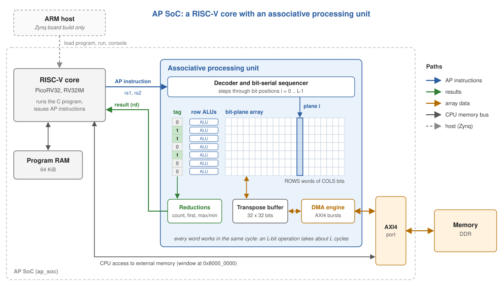
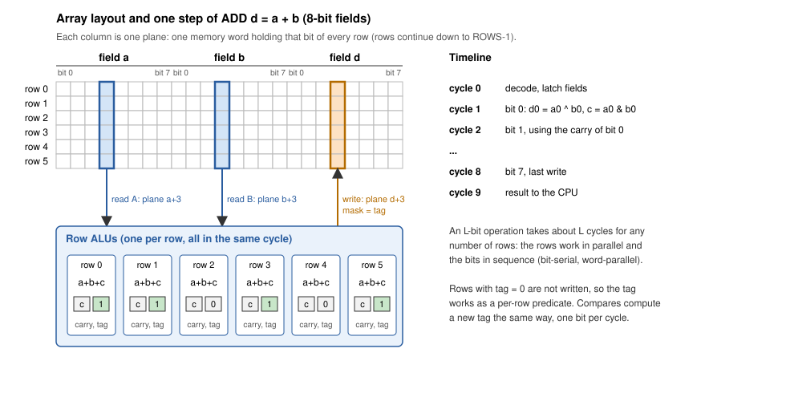
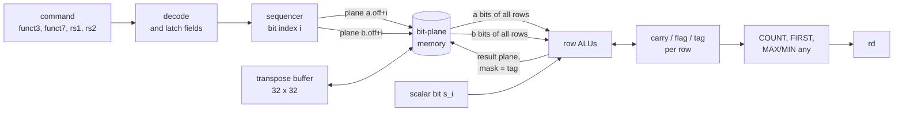
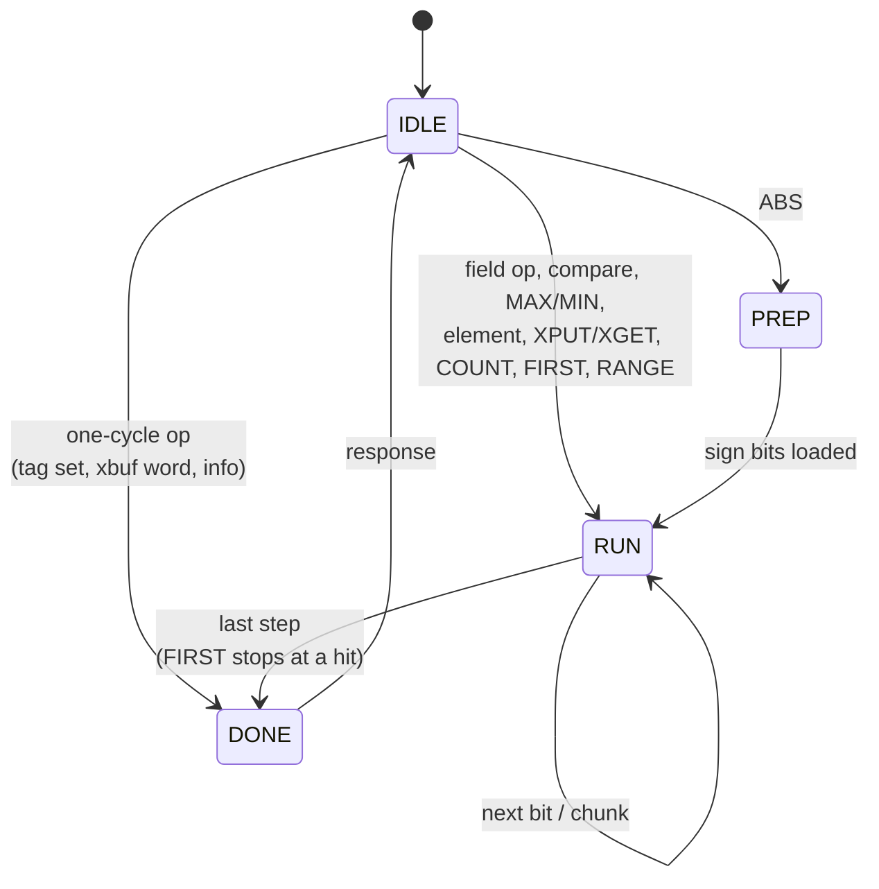
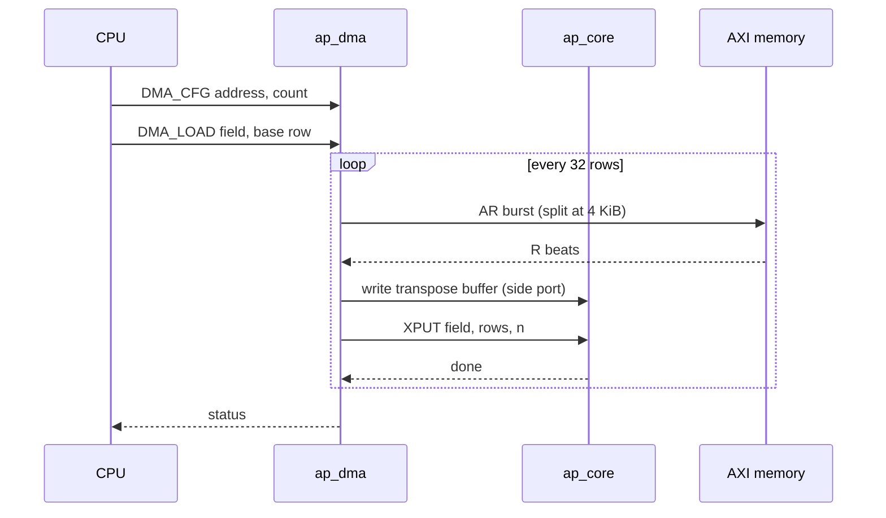
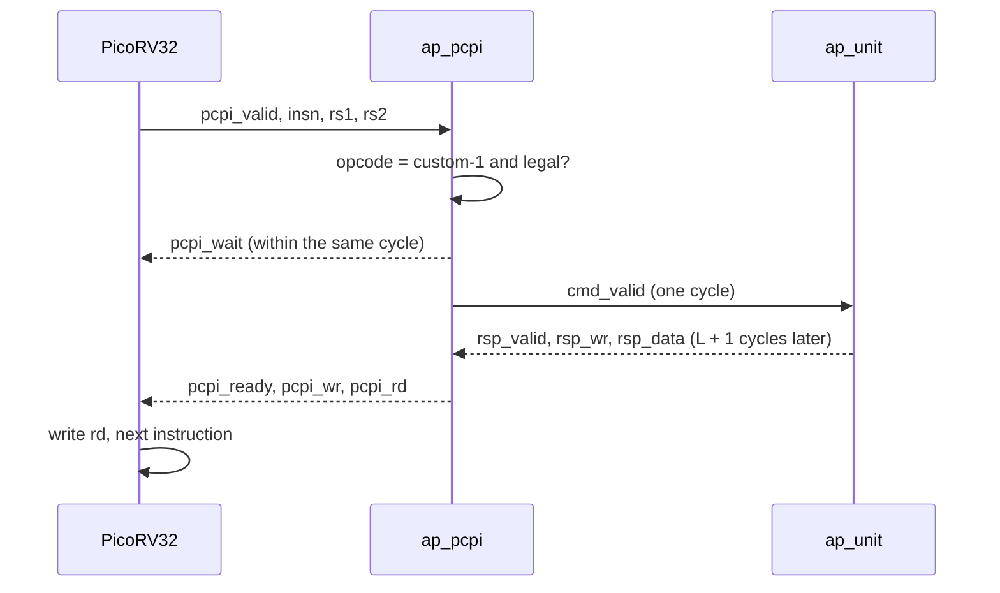

# Architecture

This document describes how the AP system is built: the SoC around it, the
AP unit, how an instruction executes, and why the design looks the way it
does. The instruction set itself is specified in [isa.md](isa.md).

## Overview



The system is a small RISC-V SoC with an associative processing (AP) unit
attached to the CPU:

* **PicoRV32** (RV32IM) runs the program from on-chip RAM, does all control
  flow and scalar work, and issues AP instructions.
* The **AP unit** holds an array of ROWS words of COLS bits and executes AP
  instructions on all rows at once. It is attached through PicoRV32's
  co-processor interface (PCPI): the CPU decodes nothing of the AP
  instructions itself, it passes them on with the values of rs1 and rs2 and
  waits for the result.
* A **DMA engine** inside the AP unit moves arrays between external memory
  and the array over AXI4. The CPU reaches the same memory through a window
  at 0x8000_0000.
* On a Zynq-7000, `ap_zynq` adds a **host interface** for the ARM core:
  control registers, a port to load the program RAM, a console FIFO, and the
  translation of the external window to a DDR buffer with bounds checking
  (see [zynq.md](zynq.md)).

| Module | File | Role |
|---|---|---|
| `ap_soc` | `rtl/soc/ap_soc.sv` | Top level: CPU, RAM, AP unit, address decode, external port |
| `ap_pcpi` | `rtl/soc/ap_pcpi.sv` | PCPI handshake to AP commands |
| `soc_ram` | `rtl/soc/soc_ram.sv` | Program/data RAM |
| `ap_unit` | `rtl/ap/ap_unit.sv` | AP core + DMA behind one command port |
| `ap_core` | `rtl/ap/ap_core.sv` | Decoder, sequencer, tag, transpose buffer, reductions |
| `ap_plane_mem` | `rtl/ap/ap_plane_mem.sv` | Bit-plane storage |
| `ap_row_alu` | `rtl/ap/ap_row_alu.sv` | Per-row bit-serial datapath |
| `ap_dma` | `rtl/ap/ap_dma.sv` | AXI4 DMA engine |
| `ap_pkg` | `rtl/ap/ap_pkg.sv` | Encodings shared by all of the above |
| `ap_zynq` | `rtl/zynq/ap_zynq.v` | Zynq top level (block design module) |
| `ap_host_bridge` | `rtl/zynq/ap_host_bridge.sv` | Host registers, program loading, console, memory window |

## The associative processing model

The AP follows the classical associative processor: a CAM array of words
("rows") with a tag bit per word, operated on by three kinds of operations.

| Operation | What happens in every row at once | Instructions |
|---|---|---|
| **Search** | compare a field with a key or another field; the outcome sets, ANDs or ORs the tag | compares (`GRP_CMP`), `TAG_*` |
| **Compute** | write a result into a field, only where the tag is set | arithmetic and logic (`GRP_VV`, `GRP_VS`) |
| **Reduce** | turn the tags into a scalar: count, first match, maximum, minimum | `COUNT`, `FIRST`, `MAX*`, `MIN*` |

All of them work **bit-serially and word-parallel**. In a CAM, an addition
is a sequence of passes per bit position: each pass compares the bits of the
operands and the carry of every word against one pattern of the truth table
and writes the corresponding sum and carry into the matching words. This
design keeps that structure but performs all passes of one bit position in a
single cycle: each word has a one-bit ALU that evaluates the whole truth table
at once (for addition, a full adder). Searches compare one bit position per
cycle in the same way and accumulate the outcome per word.

## Bit-serial, word-parallel execution



The array is stored **transposed**: memory word c (a "plane") holds bit c of
every row. An instruction on L-bit fields walks through the L bit positions;
at each one it reads the planes of the source fields, lets every row combine
its bits in a one-bit ALU, and writes the destination plane. The row ALUs keep
a carry and a flag between bit positions, which is all that is needed for
addition, subtraction and comparison.

So an L-bit operation costs about L cycles whatever the number of rows. With
ROWS = 4096 and 16-bit data that is 4096 additions in 17 cycles. The
trade-off is latency: a single addition is far slower than in the CPU's ALU,
which is why the CPU keeps all scalar work and the AP unit only gets
operations over many rows.

Each row also has a **tag** bit. Arithmetic writes only tagged rows, and
compares compute new tags, so the tag is a per-row predicate:

```c
ap_cmps(AP_LT, AP_TSET, x, 0);   // tag = (x < 0)
ap_neg(x, x);                    // x = -x where tagged
ap_tag_all();
```

On top of the tag, reductions turn a parallel result back into a scalar:
COUNT (how many rows), FIRST (which row), and MAX/MIN, which narrow the tag
to the rows holding the extreme value in one pass over the bits.

## The AP core



### Storage

`ap_plane_mem` has two asynchronous read ports and one write port with a
per-row write mask. The mask is what makes tagged writes, single-element
writes and 32-row transpose writes cheap. It also decides the FPGA mapping:
block RAM and UltraRAM only offer byte write enables, so the planes are built
from distributed (LUT) RAM, one COLS x 1 memory per row and read port. The
asynchronous reads let a bit step read, compute and write within one cycle.

### Sequencer



* **IDLE** accepts a command and latches its field descriptors, scalar and
  row operands.
* **PREP** exists only for ABS: it reads the sign plane of the source into
  the per-row flags, which then select negation row by row.
* **RUN** performs one step per cycle. Field operations visit bit positions
  LSB first; MAX/MIN visit them MSB first; COUNT, FIRST and TAG_RANGE visit
  chunks of the tag instead of bit positions: 128 rows per cycle when ROWS
  is a multiple of 128 (otherwise 64 or 32).
* **DONE** returns the result (if any) for one cycle.

### Row ALU

`ap_row_alu` is purely combinational and vectorized over all rows. Per row
it has one full adder whose inputs are chosen per operation (a, b, ~a, ~b, 0,
a XOR sign), so ADD, SUB, RSUB, NEG and ABS share it; logic operations bypass
it. For compares it updates the flag: equality accumulates bit by bit, and
less-than/greater-than are decided by the highest differing bit, which is the
last one visited, with the sense flipped at the sign bit of a signed compare.

### Transpose buffer

Moving one word between the CPU and a row costs L cycles because the word is
spread over L planes. The transpose buffer collects 32 words, and XPUT then
writes plane by plane: the plane-i bit of 32 consecutive rows is bit i of
each buffer word. XGET goes the other way. 32 words thus move in L + 1
cycles plus the 32 buffer accesses.

## DMA



A store runs the same loop backwards: XGET, then an AW/W burst from the
buffer and the B response. While a transfer runs, `ap_unit` routes the core's
command port to the DMA engine and accepts nothing else. The external port is
shared with the CPU's own accesses through a simple select: the CPU is stalled
in the DMA instruction while the engine owns the port, so the two never
overlap.

## CPU interface (PCPI)



Illegal encodings are not claimed; PicoRV32 then raises its
illegal-instruction trap after 16 cycles.

## Design decisions

**One cycle per bit position.** CAM cells can only compare and write, so a
CAM-based associative processor needs several compare/write passes per bit
of an addition (the first version of this project, and our paper, work that
way). FPGA logic is not limited to compare and write, so this version merges
the passes of a bit position into one row ALU and one cycle. The programming
model is unchanged: search sets tags, compute writes tagged words, reductions
read the tags.

**Scratchpad, not a cache.** The array is an explicit, software-managed
memory rather than a data cache that computes. A cache would have to keep
lines resident while an instruction runs over them and stay coherent with
the CPU; a scratchpad has neither problem and makes data placement visible in
the program.

**Blocking instructions.** The CPU waits for every AP instruction. This keeps
the programming model simple (results are visible to the next instruction)
at the cost of overlapping CPU and AP work. A queue with a scoreboard would
lift it; see below.

**Standard interfaces.** AXI4 for memory and PCPI for the CPU keep the AP
unit usable with other memories (DDR on a Zynq, HBM on larger cards) and portable to other
cores with a similar co-processor port.

## Limitations and next steps

* Field length is limited to 32 bits and there is no multiply; bit-serial
  multiplication (L^2 steps) would be a natural addition.
* AP instructions block the CPU, and PicoRV32 needs roughly 10 to 15 cycles
  to issue one. For short instructions (a 1-bit TAG_LOAD, a COUNT over a few
  hundred rows) issuing costs more than executing. A command queue that lets
  instructions without a result return at once, or a faster core, would
  remove most of that overhead.
* The DMA data path is 32 bits wide; wider AXI ports (256 bits for HBM)
  would move eight words per beat into the transpose buffer.
* Rows do not communicate. Shifts across rows (for stencils or prefix sums)
  would need a row-to-row path in the plane memory.
* PicoRV32 is a small multi-cycle core; it is easy to program but slow on
  the scalar side, which is visible in the example timings.
