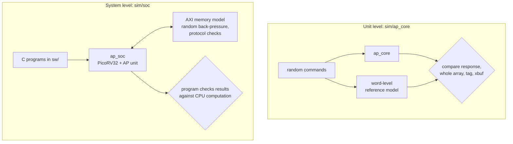

# Verification

All tests run on Verilator and are self-checking: each prints `PASS` or
`FAIL` and `make` stops at the first failure.

```bash
make test           # everything below
make -C sim ap_core # unit test of the AP core only
make -C sim soc     # programs on the SoC only
make -C sim zynq    # board programs through the Zynq top level
make -C sim host    # Zynq host program: Cortex-A9 build and benchmark parsing
make -C sim lint    # Verilator -Wall on the RTL
```



## Unit level: `sim/ap_core/tb_ap_core.sv`

The testbench drives `ap_core` directly with random commands and runs the
same commands on a reference model written at word level: it keeps the array
row by row and implements every instruction straight from
[isa.md](isa.md), with no bit planes or bit-serial steps. After **every**
command it compares

* the response (`rsp_wr`, `rsp_data`) and the `cmd_legal` decode,
* every bit of the array,
* the tag and all 32 transpose-buffer words.

The stimulus covers every group: random field placement and lengths
(including fields partly outside the array and source fields that overlap the
destination), random scalars with extreme values, row arguments past the end
of the array, partial transpose transfers, and fully random encodings to
check that illegal ones change nothing. A short directed sequence runs first.

The test runs for several array shapes (32x8, 64x48, 96x40, 128x128 and
256x16 by default, so ROWS > 32, COLS not a power of two, fields hitting the
array edge, and every width of the tag scans with one or several chunks all
occur) and several seeds, 3000 commands each. With `+latency` it also
prints the average cycle count per instruction.

**Does the test find bugs?** It was checked by deliberately breaking the RTL
and confirming that the test fails. Each of these mutations produced
mismatches in a run of 500 to 2000 commands:

| Mutation | Area |
|---|---|
| wrong initial carry of SUB | row ALU arithmetic |
| TAG_NOT leaves the tag unchanged | tag operations |
| sign bit of signed compares one position too low | compare |
| MAX/MIN ignore the sign bit | search |
| XGET reads the wrong 32-row segment | transpose buffer |
| TAG_RANGE includes the upper bound | tag range |
| TAG_RANGE uses the wrong chunk base | tag scans of 128 rows per cycle |

## System level: `sim/soc/tb_soc.sv`

The SoC testbench loads a program into the on-chip RAM, provides the console
and exit registers, and attaches an AXI4 memory model of 4 MiB as external
memory. Every program in `sw/tests` and `sw/examples` runs twice: once with an
ideal memory and once with `+axi_stall=30`, where the model randomly holds off
30% of all handshakes.

* `tests/hello.c` is a smoke test of the CPU, the console and the PCPI path.
* `tests/ap_isa_test.c` runs every AP instruction through the real
  instruction path and checks the results against the same computation done
  by the CPU: all arithmetic and logic operations with a partial tag, all
  compare conditions and modes, tag operations, reductions, element and
  transpose-buffer access, and DMA, including a transfer that crosses a
  4 KiB boundary and one that runs off the end of memory and must report an
  error.
* The four examples check their results against a CPU implementation and
  return the number of mismatches.

The AXI memory model also checks the protocol: bursts that cross a 4 KiB
boundary, unsupported burst types, and WLAST that does not match AWLEN count
as violations, and any violation fails the run. Removing the 4 KiB burst
split from the DMA engine, for example, is reported this way even though the
data still arrives correctly in simulation.

## Zynq top level: `sim/zynq/tb_ap_zynq.sv`

The testbench plays the ARM host of the board build (docs/zynq.md) at the
board's array shape (512 x 64): over AXI4-Lite it checks the ID and shape
registers, loads a program into the program RAM and reads part of it back,
checks that the RAM refuses writes while the SoC runs, places the external
window 4 MiB into an 8 MiB memory model, starts the program, drains the
console FIFO and checks the exit code. It fails the run if the SoC ever
accesses memory outside the window; the DMA error case of the ISA test
deliberately runs past the end of the window and must get an error back from
the bridge instead. All seven programs the board host runs pass this way,
with and without AXI back-pressure.

The host program (`fpga/zynq/host/main.c`) cannot run without the board, so
`make -C sim host` checks what can be checked without it: it compiles the
program for the Cortex-A9 against stub BSP headers (`sim/zynq/bsp/`) with all
warnings as errors, once as for a classic BSP with `xtime_l.h` and once as for
a system-device-tree BSP without it (Vitis 2023.2 and later), and runs its
benchmark parsing and ARM-side workloads
natively on the output of the scaling benchmark from the Zynq simulation;
every result must match.

## Lint

The RTL is clean under `verilator --lint-only -Wall`. Waivers in
`sim/verilator.vlt` are limited to the third-party PicoRV32 file, unused
package constants, and blocking assignments / partly used signals in
testbenches.

## Continuous integration

`.github/workflows/ci.yml` installs Verilator, the RISC-V GCC toolchain and
Yosys from Ubuntu packages and runs `make test` and `make synth` on every
push and pull request.

## What is not covered

* Hardware in CI. The board run (docs/zynq.md) is done by hand; on the
  ALINX AX7Z020B every program passed with the cycle counts of the
  simulation, apart from DDR latency.
* Clock-domain crossings: the design uses a single clock.
* Very large arrays in simulation. The tests use up to 512 rows; larger
  shapes are only synthesized.
