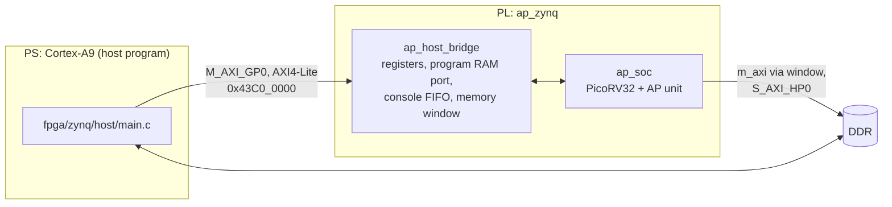

# Running on a Zynq-7000 board

This guide brings the AP SoC up on a Zynq-7000 board. The ARM Cortex-A9 of
the Zynq acts as the host: it loads the RISC-V programs into the SoC, starts
them, prints their output, and runs the same benchmark workloads itself for
comparison.

Status: tested on an ALINX AX7Z020B (XA7Z020-1CLG400I) with Vivado and Vitis
2023.2. All seven programs pass with the cycle counts of the simulation
(`make -C sim zynq`), except where DDR latency enters, and timing is met at
50 MHz. The results are in [section 4](#4-results-on-the-board).



## What you need

* The board, its USB JTAG and UART connection, power.
* The board must not start an operating system on its own, or the debugger
  cannot take over the ARM reliably: set the boot mode to JTAG, or take out
  the SD card if the board boots Linux from it.
* Vivado and Vitis of the same version (tested with 2023.2), with the
  embedded part of Vitis: if **File > New Component** in Vitis offers only
  HLS, add *Vitis Embedded Development* with the installer (for Vivado ML
  Standard: *Add Design Tools or Devices*).
* The PS configuration of the board (next section).

Nothing in the programmable logic uses package pins, so the design needs no
constraints file; everything board-specific is in the PS configuration.

## Connect and check the board

1. With the power off, connect the JTAG cable to the board's JTAG header
   (use the ribbon that matches it, 10 or 14 pins), the board's USB-UART
   port to the PC, and the power supply. Plug and unplug the JTAG ribbon only
   while the board is off.
2. Drivers: the JTAG cable uses the cable drivers of Vivado (on Windows, run
   `data/xicom/cable_drivers/nt64/install_drivers_wrapper.bat` of the Vivado
   installation as administrator if the cable is not recognized). The
   USB-UART bridge needs its vendor's driver (for example Silicon Labs
   CP210x) and then appears as a serial port (COM port on Windows).
3. Power on. In Vivado, **Open Hardware Manager > Open Target > Auto
   Connect** must list `arm_dap_0` and the FPGA (an XA7Z020 is listed as
   `xc7z020`).
4. Open a serial terminal on that port: 115200 baud, 8N1, no flow control.
   In PuTTY, also enable **Terminal > Implicit CR in every LF**.
5. If the terminal shows an operating system booting after power-on, take
   out the SD card or set the boot mode to JTAG (see above).

## 1. Get the PS configuration of the board

The processing system needs the board's DDR parameters, clocks and MIO
assignment (UART). Take them from any working Vivado project for the board,
for example a PS example from the board vendor's material:

1. Open the project in Vivado (accept the upgrade if asked) and open its
   block design.
2. Double-click the ZYNQ7 Processing System block.
3. **Presets > Save Configuration**, save as e.g. `ax7z020b_ps7.tcl`.

If the vendor provides Vivado board files instead, create a project for the
board, add a ZYNQ7 Processing System, run the block automation with "apply
board preset", and save the configuration the same way.

ALINX boards: the example projects ALINX publishes for each board (on Gitee,
for example `alinxalinx_0/AX7Z020B_2023.1`) recreate their PS from a script,
`course_s2_vitis/01_ps_uart/Vivado/auto_create_project/ps_config.tcl`. The
build script accepts that file as it is (`preset=path/to/ps_config.tcl`), so
there is no need to open the project.

Also check the part printed on the FPGA (for example `XC7Z020 CLG400-2`
means part `xc7z020clg400-2`; `-1` means `xc7z020clg400-1`). Some boards
carry the automotive `XA7Z020`, which comes only in speed grade -1: use
`xa7z020clg400-1I` (or `-1Q`).

## 2. Build the hardware

From the repository root, in a terminal where `vivado` is on the PATH (on
Linux after sourcing `settings64.sh`, on Windows in a command prompt after
running `settings64.bat` of the Vivado installation):

```bash
vivado -mode batch -source fpga/zynq/build.tcl -tclargs preset=path/to/ax7z020b_ps7.tcl
```

Or in the Tcl Console of the Vivado GUI, with the options in `argv`:

```tcl
cd path/to/repository
set argv {preset=path/to/ps_config.tcl part=xa7z020clg400-1I}
source -notrace fpga/zynq/build.tcl
```

Use forward slashes in paths, also on Windows, and keep the repository in a
short path without spaces.

Options (`key=value`): `part=` (default `xc7z020clg400-2`), `rows=` and
`cols=` (array shape, default 512 x 64), `fclk=` (SoC clock in MHz, default
50), `jobs=`, `dir=` (default `vivado_zynq`).

On the XA7Z020 the build uses 27,500 LUTs (52%) and 16 block RAMs and meets
timing at 50 MHz with 0.42 ns of slack ([synthesis.md](synthesis.md#boards)).

The script creates the block design, runs synthesis and implementation,
writes the bitstream and `vivado_zynq/ap_zynq.xsa`, and prints the worst
setup slack. A negative slack means the clock is too fast for this build:
rebuild with a lower `fclk=`. With positive slack, try a higher clock; the
benchmark results scale with it.

Utilization and timing reports are in `vivado_zynq/utilization.txt` and
`vivado_zynq/timing.txt`. Opening `vivado_zynq/ap_zynq.xpr` in the GUI shows
the block design.

## 3. Build and run the host program

In the Vitis unified IDE (menu names as in 2023.2):

1. **Set Workspace** to an empty folder outside the repository.
2. **File > New Component > Platform**: flow *Hardware Design* with
   `vivado_zynq/ap_zynq.xsa`, operating system *standalone*, processor
   *ps7_cortexa9_0*. Build the platform.
3. Optional but useful the first time: **File > New Component > From
   Examples**, *Hello World* on that platform. If it prints on the UART,
   JTAG, the PS configuration (DDR, clocks) and the UART all work.
4. **File > New Component > Application**: an empty application on the
   platform and its *standalone* domain.
5. Copy into the application's `src` folder:
   * `fpga/zynq/host/main.c`, `ap_regs.h`, `ap_programs.h`
   * `sw/include/bench.h`
6. In the application's `UserConfig.cmake`, set **Optimization level** to
   `-O3`. The ARM side of the benchmark is only as fast as this setting
   allows.
7. Build, connect a serial terminal to the board's UART (115200 baud, 8N1, no
   flow control), and **Run** the application. Vitis programs the bitstream,
   initializes the PS and starts the program.

The host program needs the RISC-V programs as `ap_programs.h`, which is
generated from `sw/` and kept in the repository. After changing anything in
`sw/`, regenerate it on a machine with the RISC-V toolchain:

```bash
make -C sw zynq
```

## 4. Results on the board

The program first checks that the SoC answers and measures its clock, then
runs each RISC-V program and prints its console output and result. Output of
the ALINX AX7Z020B (shortened):

```
AP SoC host
array 512 rows x 64 columns, SoC clock 49999864 Hz, external memory at 0x00400000

=== hello ===
AP v2.0.0: 512 rows x 64 columns
1200 + 34 = 1234
[hello] exit code 0, 5439 cycles (108 us)

=== ap_isa_test ===
AP ISA test: 512 rows, 64 columns
...
0 errors
[ap_isa_test] exit code 0, 6931636 cycles (138633 us)

=== vector_add ===
...
=== scaling ===
scaling benchmark, 512 rows x 64 columns
BENCH add 32 46 2256427
...
BENCH hist16 512 764 4438
0 mismatches
[scaling] exit code 0, 790709 cycles (15814 us)
```

The complete output is in
[fpga/zynq/results/ax7z020b.txt](../fpga/zynq/results/ax7z020b.txt).
Each `BENCH` line is: workload, n, AP cycles, result. The cycle counts are
the same as in simulation (`make -C sim zynq`) except for the transfers to
and from DDR, which take longer on the board (the DMA round trip of
`vector_add`: 3250 cycles against 2700). After the scaling benchmark
the host runs the same workloads on the Cortex-A9 (666 MHz), on the same
data:

```
AP (SoC at 49.9 MHz) vs Cortex-A9, same data, time per run
workload     n  AP cycles      AP us      A9 us   A9/AP  result
add         32         46       0.92       0.21    0.23  same
add         64         46       0.92       0.41    0.45  same
add        128         46       0.92       0.78    0.85  same
add        256         46       0.92       1.56    1.69  same
add        512         46       0.92       3.09    3.36  same
range       32         88       1.76       0.41    0.23  same
range       64         88       1.76       0.77    0.43  same
range      128         88       1.76       1.59    0.90  same
range      256         88       1.76       3.40    1.93  same
range      512         88       1.76       7.68    4.36  same
argmax      32         44       0.88       0.35    0.40  same
argmax      64         44       0.88       0.56    0.64  same
argmax     128         44       0.88       1.00    1.13  same
argmax     256         45       0.90       1.86    2.07  same
argmax     512         47       0.94       3.59    3.82  same
top8        32        576      11.52       1.26    0.10  same
top8        64        576      11.52       2.20    0.19  same
top8       128        576      11.52       3.65    0.31  same
top8       256        579      11.58       4.81    0.41  same
top8       512        586      11.72       6.88    0.58  same
hist16      32        764      15.28       0.56    0.03  same
hist16      64        764      15.28       0.84    0.05  same
hist16     128        764      15.28       1.40    0.09  same
hist16     256        764      15.28       2.55    0.16  same
hist16     512        764      15.28       4.82    0.31  same

PASS: 0 of 7 programs failed
```

* **AP us** is the time measured by the RISC-V program around the AP
  instructions, including the cost of issuing them; it is almost the same
  for every n, because all rows work at once.
* **A9 us** is the time of the C version (`sw/include/bench.h`) on the
  Cortex-A9, built with `-O3`; it grows with n.
* **A9/AP** above 1 means the AP is faster. **result** compares the result of
  both sides; it must read `same`.

## Interpreting the numbers

The AP's time per instruction depends on the field width, not on the number
of rows, while the ARM's time grows with the number of elements. On the
board, a 512-row array at 50 MHz against a 666 MHz Cortex-A9 with caches:

* Element-wise arithmetic (`add`), a search over three conditions with a
  count (`range`) and `argmax` break even between 128 and 256 elements; at
  512 elements the AP is 3.4 to 4.4 times faster.
* Workloads made of many small AP instructions (`hist16`, `top8`) stay
  faster on the ARM at this size (0.3 and 0.6 at 512 elements): each AP
  instruction does only a few cycles of work there, and issuing it from
  PicoRV32, a small multi-cycle core, costs more than that.

The ARM baseline is plain C compiled for the default floating-point unit of
the Vitis BSP (VFPv3, no NEON auto-vectorization); hand-written NEON code
would be faster on `add` and `range`.

The crossover moves toward the AP as the array grows or the SoC clock rises.
See [architecture.md](architecture.md#limitations-and-next-steps) for the
changes that would shift it further.

## Troubleshooting

| Symptom | Cause |
|---|---|
| Linux boot messages on the UART; Vitis reports `Memory write error at 0xF8F00208` | The board boots its own operating system. Take out the SD card or set the boot mode to JTAG. |
| **File > New Component** offers only HLS | The embedded part of Vitis is not installed (see "What you need"). |
| `no AP SoC at 0x43c00000` | Bitstream not loaded, or the address in `ap_regs.h` differs from the block design. |
| No UART output at all | PS configuration does not match the board (DDR or UART MIO), or wrong serial port / baud rate. |
| A program times out or traps | Timing not met (check the slack, lower `fclk=`), or the program image is stale (`make -C sw zynq`). |
| `result DIFFERENT` | Report it with the full output; simulation (`make -C sim zynq`) runs the same code. |
