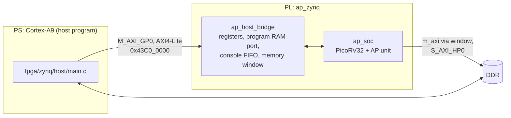

# Running on a Zynq-7000 board

This guide brings the AP SoC up on a Zynq-7000 board, for example an ALINX
AX7Z020B (XC7Z020). The ARM Cortex-A9 of the Zynq acts as the host: it loads
the RISC-V programs into the SoC, starts them, prints their output, and runs
the same benchmark workloads itself for comparison.

Status: the Zynq top level, its host interface and all programs are verified
in simulation at the board's array shape (`make -C sim zynq`), and the host
program is checked as far as possible without the board (`make -C sim
host`). The Vivado build and the run on hardware are the steps below.



## What you need

* The board, its USB JTAG and UART connection, power. Boot mode set to JTAG.
* Vivado and Vitis (the script and steps are written for 2025.1).
* The PS configuration of the board (next section).

Nothing in the programmable logic uses package pins, so the design needs no
constraints file; everything board-specific is in the PS configuration.

## 1. Get the PS configuration of the board

The processing system needs the board's DDR parameters, clocks and MIO
assignment (UART). Take them from any working Vivado project for the board,
for example a PS example from the board vendor's material:

1. Open the project in Vivado (accept the upgrade if asked) and open its
   block design.
2. Double-click the ZYNQ7 Processing System block.
3. **Presets > Save Configuration**, save as e.g. `ax7z020b_ps7.tcl`.

If the vendor provides Vivado board files instead, create a project for the
board, add a ZYNQ7 Processing System, run the block automation with "apply
board preset", and save the configuration the same way.

Also check the speed grade printed on the FPGA (for example `XC7Z020
CLG400-2` means part `xc7z020clg400-2`; `-1` means `xc7z020clg400-1`).

## 2. Build the hardware

From the repository root, in a terminal where `vivado` is on the PATH (on
Windows, the "Vivado 2025.1 Tcl Shell" or a command prompt after running
`settings64.bat` of the Vivado installation):

```bash
vivado -mode batch -source fpga/zynq/build.tcl -tclargs preset=path/to/ax7z020b_ps7.tcl
```

Use forward slashes in paths, also on Windows.

Options (`key=value`): `part=` (default `xc7z020clg400-2`), `rows=` and
`cols=` (array shape, default 512 x 64), `fclk=` (SoC clock in MHz, default
50), `jobs=`, `dir=` (default `vivado_zynq`).

The script creates the block design, runs synthesis and implementation,
writes the bitstream and `vivado_zynq/ap_zynq.xsa`, and prints the worst
setup slack. A negative slack means the clock is too fast for this build:
rebuild with a lower `fclk=`. With positive slack, try a higher clock; the
benchmark results scale with it.

Utilization and timing reports are in `vivado_zynq/utilization.txt` and
`vivado_zynq/timing.txt`. Opening `vivado_zynq/ap_zynq.xpr` in the GUI shows
the block design.

## 3. Build and run the host program

In Vitis (the unified IDE; menu names can differ slightly between versions):

1. Open an empty folder as workspace.
2. **File > New Component > Platform**: hardware design
   `vivado_zynq/ap_zynq.xsa`, operating system *standalone*, processor
   *ps7_cortexa9_0*. Build the platform.
3. **File > New Component > Application**: an empty C application on that
   platform.
4. Copy into the application's `src` folder:
   * `fpga/zynq/host/main.c`, `ap_regs.h`, `ap_programs.h`
   * `sw/include/bench.h`
5. Set the compiler optimization to `-O2` or `-O3` (application settings).
   The ARM side of the benchmark is only as fast as this setting allows.
6. Build, connect a serial terminal to the board's UART (115200 baud, 8N1),
   and **Run** the application. Vitis programs the bitstream and starts the
   program.

The host program needs the RISC-V programs as `ap_programs.h`, which is
generated from `sw/` and kept in the repository. After changing anything in
`sw/`, regenerate it on a machine with the RISC-V toolchain:

```bash
make -C sw zynq
```

## 4. What you see

The program first checks that the SoC answers and measures its clock, then
runs each RISC-V program and prints its console output and result. The same
programs, at the same array shape, also run in simulation (`make -C sim
zynq`), so the output below is what the board should print. Cycle counts of
programs that use external memory vary a little with the DDR latency.

```
AP SoC host
array 512 rows x 64 columns, SoC clock 50000000 Hz, external memory at 0x...

=== hello ===
AP v2.0.0: 512 rows x 64 columns
1200 + 34 = 1234
[hello] exit code 0, 5439 cycles (108 us)

=== ap_isa_test ===
...
0 errors
[ap_isa_test] exit code 0, ...

=== scaling ===
scaling benchmark, 512 rows x 64 columns
BENCH add 32 46 2256427
BENCH add 64 46 4195654
...
BENCH hist16 512 764 4438
0 mismatches
```

Each `BENCH` line is: workload, n, AP cycles, result.

After the scaling benchmark the host runs the same workloads on the
Cortex-A9, on the same data, and prints a table:

```
AP (SoC at 50.0 MHz) vs Cortex-A9, same data, time per run
workload     n  AP cycles      AP us      A9 us   A9/AP  result
add         32         46       0.92       ....    ....  same
...
hist16     512        764      15.28       ....    ....  same
```

(The A9 columns come from the board.)

* **AP us** is the time measured by the RISC-V program around the AP
  instructions, including the cost of issuing them; it is almost the same
  for every n, because all rows work at once.
* **A9 us** is the time of the C version (`sw/include/bench.h`) on the
  Cortex-A9; it grows with n.
* **A9/AP** above 1 means the AP is faster. **result** compares the result of
  both sides; it must read `same`.

The program ends with `PASS` when every RISC-V program exited with 0 and
every benchmark result matched.

## Interpreting the numbers

The AP's time per instruction depends on the field width, not on the number
of rows, while the ARM's time grows with the number of elements. On an
XC7Z020 the array is small (hundreds of rows) and runs at tens of MHz, while
the Cortex-A9 runs at several hundred MHz with caches. Expect:

* searches over several conditions (`range`) to favour the AP,
* simple element-wise arithmetic (`add`) to be close,
* workloads made of many small AP instructions (`hist16`, `top8`) to favour
  the ARM at this size: each AP instruction does only a few cycles of work
  there, and issuing it from PicoRV32 (a small multi-cycle core) costs more
  than that.

The crossover moves toward the AP as the array grows or the SoC clock rises,
which is what the table across n shows. See
[architecture.md](architecture.md#limitations-and-next-steps) for the
changes that would shift it further.

## Troubleshooting

| Symptom | Cause |
|---|---|
| `no AP SoC at 0x43c00000` | Bitstream not loaded, or the address in `ap_regs.h` differs from the block design. |
| No UART output at all | PS configuration does not match the board (DDR or UART MIO), or wrong serial port / baud rate. |
| A program times out or traps | Timing not met (check the slack, lower `fclk=`), or the program image is stale (`make -C sw zynq`). |
| `result DIFFERENT` | Report it with the full output; simulation (`make -C sim zynq`) runs the same code. |
